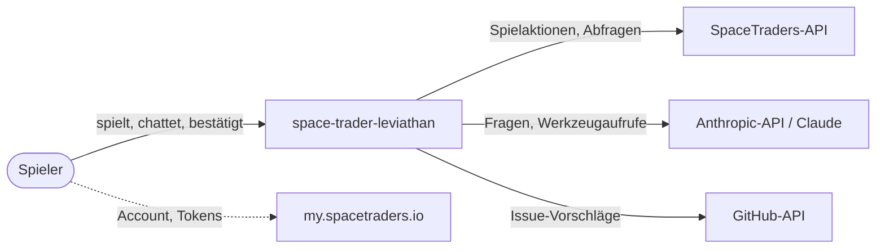

# 3 Kontextabgrenzung

## Kurz gesagt

space-trader-leviathan läuft auf dem Rechner des Spielers. Er holt Spieldaten von der SpaceTraders-API und führt dort Aktionen aus, schickt Fragen an Claude über die Anthropic-API und legt auf Wunsch GitHub-Issues in diesem Repository an. Alle drei Verbindungen laufen über den [Kern](../glossary/Kern.md), nie direkt aus der Oberfläche.

## Fachlicher Kontext

| Partner | Eingang | Ausgang |
|---|---|---|
| Spieler | Spielansichten, Antworten des Board-Computers, Hinweise | Aktionen, Fragen, Bestätigungen, Einstellungen |
| SpaceTraders-API | Spielzustand, Ergebnisse von Aktionen | Abfragen und Aktionen des Agents |
| Anthropic-API | Antworten und Werkzeugaufrufe von Claude | Gesprächsverlauf, Werkzeugergebnisse (ohne Geheimnisse) |
| GitHub-API | Link zum angelegten Issue, Duplikat-Treffer | bestätigte Issue-Vorschläge |
| my.spacetraders.io | Account- und Agent-Tokens (vom Spieler kopiert) | – |

## Technischer Kontext

| Verbindung | Protokoll | Authentifizierung | Grenzen |
|---|---|---|---|
| SpaceTraders | HTTPS, REST, JSON, `https://api.spacetraders.io/v2` | Bearer: Account- oder Agent-Token ([Authentifizierung](../api/authentifizierung.md)) | [Rate-Limits](../api/rate-limits.md) |
| Anthropic | HTTPS über `@anthropic-ai/sdk`, Streaming | API-Key des Spielers | Kosten- und Tokenlimit je Tag (Issue #21) |
| GitHub | HTTPS, REST | Fine-grained Token mit „Issues: write“ für dieses Repository | nur nach Bestätigung (Issue #24) |

## Bezüge

- [Kapitel 5: Bausteinsicht](05-bausteinsicht.md), [API-Überblick](../api/ueberblick.md)
