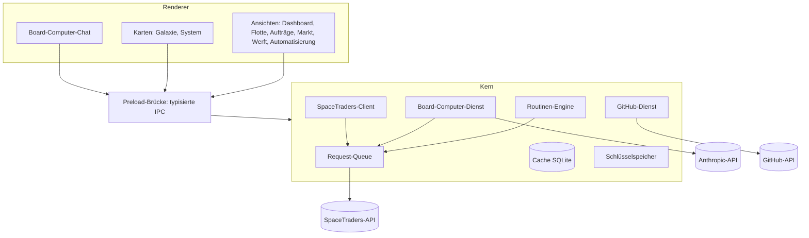

# 5 Bausteinsicht

## Kurz gesagt

Ebene 1 hat drei Bausteine: den [Renderer](../glossary/Renderer.md) (Oberfläche), die Preload-Brücke (typisierte IPC) und den [Kern](../glossary/Kern.md). Der Kern enthält alle fachlichen Dienste. Die Bausteine sind geplant und noch nicht umgesetzt; die Issues nennen den Stand.

## Ebene 1

| Baustein | Verantwortung | Issues |
|---|---|---|
| Renderer | Darstellung, Eingaben, Karten, Chat-Oberfläche; keine Geheimnisse | #10 bis #20, #27 bis #31, #38 |
| Preload-Brücke | stellt eine kleine, typisierte Schnittstelle bereit und prüft Eingaben | #9 |
| SpaceTraders-Client | erzeugter API-Client, Fehler-Mapping | #5 |
| [Request-Queue](../glossary/Request-Queue.md) | Rate-Limit, Prioritäten, Wiederholen | #6 |
| Cache | Spielstand, Marktpreis-Zeitreihen, Daten je Reset, Ereignisse an den Renderer | #8 |
| Routinen-Engine | [Routinen](../glossary/Routine.md) als Zustandsautomaten, Scheduler, Tray-Betrieb | #32 bis #37 |
| Board-Computer-Dienst | Claude-Anbindung, Werkzeuge, Bestätigungen, Audit-Log | #21 bis #26, #39 |
| GitHub-Dienst | Duplikatsuche und Anlage von Issues | #24 |
| Schlüsselspeicher | Agent-Tokens, Account-Token, Anthropic-Key, GitHub-Token über `safeStorage` | #7, #9 |

## Ebene 2: Board-Computer-Dienst

| Teil | Aufgabe |
|---|---|
| Gesprächsverwaltung | Verlauf je Agent, Streaming an den Renderer, Kosten zählen |
| Lesende Werkzeuge | Agent, Flotte, Aufträge, Markt, Systeme, Route, Routinen; lesen aus dem Cache |
| Schreibende Werkzeuge | Spielaktionen und Routinen; jede erzeugt eine Bestätigung im Chat |
| Issue-Werkzeug | Vorschlag, Bearbeitung, Duplikatsuche, Anlage nach Bestätigung |
| Schutzschicht | kennzeichnet Spieldaten als Daten, filtert Geheimnisse, schreibt das Audit-Log |

## Bezüge

- [Kapitel 6: Laufzeitsicht](06-laufzeitsicht.md), [Kapitel 8: Konzepte](08-konzepte.md)
