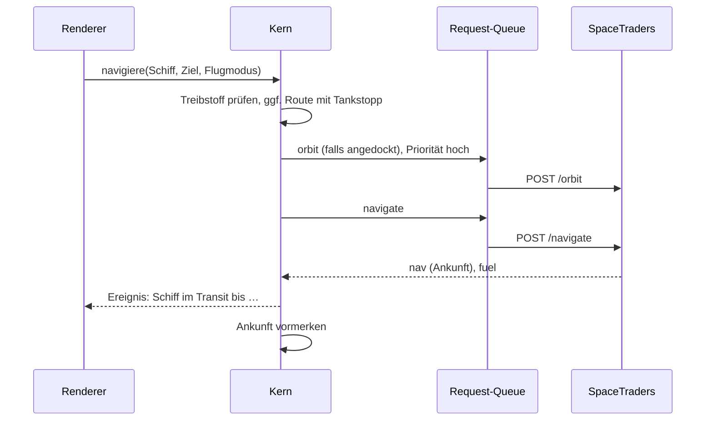

# 6 Laufzeitsicht

## Kurz gesagt

Vier Abläufe prägen den Client: eine Nutzeraktion wie die Navigation, ein Zyklus einer [Routine](../glossary/Routine.md), eine Frage an den [Board-Computer](../glossary/Board-Computer.md) mit Werkzeugaufrufen und die Anlage eines GitHub-Issues aus dem Chat. Allen gemeinsam: Jede Anfrage an SpaceTraders läuft durch die [Request-Queue](../glossary/Request-Queue.md), und jede Antwort aktualisiert den Cache, der die Oberfläche benachrichtigt.

## Navigation per Klick

## Routinen-Zyklus Abbau und Verkauf

1. Scheduler weckt die Routine, wenn Ankunft oder Cooldown abgelaufen ist.
2. Routine liest den Zustand aus dem Cache und wählt den nächsten Schritt: Survey, Abbau, Abwerfen, Navigation zum Markt, Verkaufen, Tanken oder Rückflug.
3. Der Schritt geht mit Priorität „Automatisierung“ in die Queue.
4. Die Antwort aktualisiert Cache und Protokoll; der neue Zustand wird gespeichert.
5. Fehler: wiederholbar wird später erneut versucht, fachlich pausiert die Routine und benachrichtigt den Spieler.

## Frage an den Board-Computer

1. Der Spieler fragt im Chat, optional mit Kontext (aktuelle Ansicht, gewähltes Schiff).
2. Der Kern sendet Verlauf, Systemprompt und Werkzeugliste an Claude (Streaming).
3. Claude ruft lesende Werkzeuge auf; der Kern beantwortet sie aus dem Cache, gekennzeichnet als Daten.
4. Schreibende Werkzeuge erzeugen eine Bestätigungskarte. Erst nach „Ausführen“ geht die Aktion in die Queue; das Ergebnis oder die Ablehnung geht an Claude zurück.
5. Die Antwort erscheint gestreamt; Verweise auf Schiffe und Wegpunkte sind klickbar.

## Wie der Board-Computer ein GitHub-Issue anlegt

1. Claude erkennt eine fehlende Funktion oder einen Fehler und ruft das Issue-Werkzeug mit Titel, Ziel, Aufgaben und Akzeptanzkriterien auf.
2. Der Kern sucht offene Issues nach Duplikaten und zeigt Vorschlag und Treffer als Karte.
3. Der Spieler bearbeitet, verwirft oder bestätigt.
4. Nach Bestätigung legt der GitHub-Dienst das Issue an; der Link erscheint im Chat und im Audit-Log.

## Server-Reset

Beim Start und regelmäßig prüft der Kern `GET /`. Ändert sich `resetDate`, stoppt er alle Routinen, archiviert den alten Datenstand und führt den Spieler zur Registrierung eines neuen Agents ([Server-Reset](../spacetraders/server-reset.md)).

## Bezüge

- [Kapitel 5: Bausteinsicht](05-bausteinsicht.md), [Navigation](../spacetraders/navigation.md), [Abbau](../spacetraders/abbau.md)
