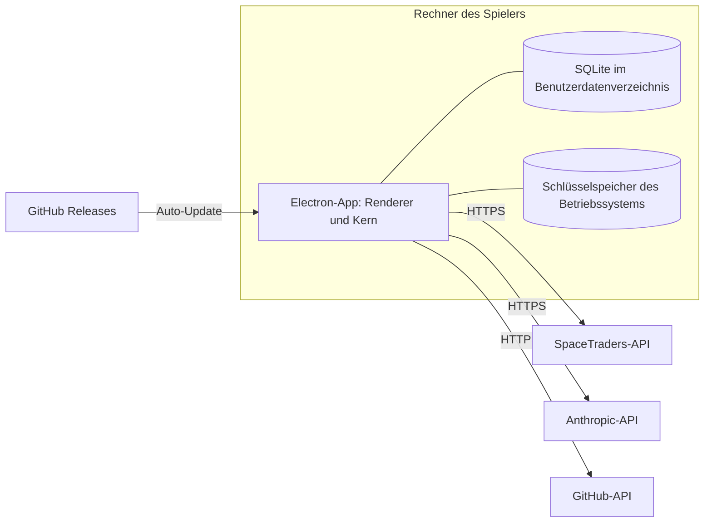

# 7 Verteilungssicht

## Kurz gesagt

Es gibt keinen eigenen Server. Die App läuft auf dem Rechner des Spielers und speichert ihre Daten im Benutzerdatenverzeichnis. Routinen arbeiten, solange die App läuft, auch mit geschlossenem Fenster im Tray. Ein Dauerbetrieb rund um die Uhr setzt einen durchlaufenden Rechner voraus.

## Infrastruktur

| Element | Inhalt |
|---|---|
| Installationspaket | Windows (NSIS), macOS (dmg, signiert und notarisiert), Linux (AppImage), erzeugt mit `electron-builder` (Issue #40) |
| Benutzerdatenverzeichnis | SQLite-Cache, Logs, Einstellungen; Export und Import als Backup |
| Schlüsselspeicher | Tokens und Keys, verschlüsselt über `safeStorage` |
| GitHub Releases | Versionen und Auto-Update über `electron-updater` |

## Bezüge

- ADR-01 in [Entscheidungen](../decisions.md), [Kapitel 11: Risiken](11-risiken.md)
